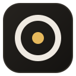
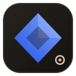
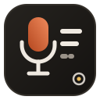

  <picture>
    <source media="(prefers-color-scheme: dark)" srcset="monad-logo-white.svg">
    
  </picture>

# The Monad brand

Monad is a family of local AI apps. The brand says one thing: **nothing comes in, nothing goes out.** Every
app keeps its own name, icon and color, and signs itself as part of the family in the same way.

## The name

For Leibniz, a monad is a self-sufficient unit with no windows through which anything could come in or go
out. Monad apps run their models on your computer, and what you give them stays there.

- Write it **Monad**, with a capital M, and the apps by their own name: *Lectern*, *OVMS Manager*.
- An app is "a Monad app", "part of Monad". The family is not a prefix: *Lectern*, not *Monad Lectern*.
- Repositories are named after the app (`VarCode-ai/lectern`); the family lives in `VarCode-ai/monad`.

## The symbol

  
  

The circumpunct ⊙, a circle around a point, is the ancient sign of the monad: a boundary, and something
that stays inside it. In the logo it is the *o* of "monad", and its point is the only gold in the brand.

| File | Use |
| --- | --- |
| [`monad-logo.svg`](monad-logo.svg), [`monad-logo-white.svg`](monad-logo-white.svg) | The wordmark, on light and dark backgrounds |
| [`monad-mark.svg`](monad-mark.svg), [`monad-mark-white.svg`](monad-mark-white.svg) | The symbol alone, for small spaces and footers |
| [`monad-icon.svg`](monad-icon.svg) | The symbol in the app icon frame (avatars, social previews) |

In a README, switch between the two versions with `<picture>` and `prefers-color-scheme`, as this page
does. Leave the logo room to breathe, and don't recolor, stretch or outline it.

The wordmark is drawn with strokes, not with a font: geometric lowercase letters with an 8-unit stroke,
round caps, an x-height of 44 units and bowls of radius 22.

## Colors

| Role | Light | Dark |
| --- | --- | --- |
| Ink (wordmark, text) |  `#1c1b19` |  `#f2eee8` |
| Gold (the point) |  `#9a6415` |  `#e6b85c` |
| Icon frame |  `#26231f` → `#141210` | |

The gold reaches the WCAG AA contrast for text on white (4.99:1) and on dark backgrounds (10.25:1).

### App accents

Each app has one accent, defined in the kit (`ACCENTS` in [`common/ui_kit.py`](../../common/ui_kit.py)) and
checked for contrast by `tools/check_contrast.py`. The same color is used for the app's icon, its README
badges and its interface.

| App | Accent | Light | Dark |
| --- | --- | --- | --- |
| OVMS Manager | electric |  `#2552e0` |  `#7da3ff` |
| Lectern | ember |  `#b4471f` |  `#ef8a5c` |

A new app picks a hue that is clearly different from these, and keeps gold for the family.

## App icons

  
  

Every app icon is built from the same template, a 128×128 SVG:

1. **The frame**: a rounded square (`x=6 y=6`, 116×116, `rx=28`) with a diagonal gradient from `#26231f`
   to `#141210` and a 2-unit border `#34302a`.
2. **The glyph**: one simple shape that says what the app does, filled with a gradient of the app accent,
   from the light accent at the bottom left to the dark-theme accent at the top right. Details are
   drawn in warm white `#efe9e1`.
3. **The signature**: the Monad point in the bottom right corner, a ring of radius 7 centered at
   `(101, 101)` (2.5-unit `#efe9e1` stroke) around a gold dot `#e6b85c` of radius 2.6.

The app icons in [`apps/`](apps/) are copies; the original of each icon lives in its app repository.

## README header

Every app README opens the same way, so the family is recognizable at a glance:

1. the Monad logo (light/dark), linking to this repository;
2. the app icon and its name as the title;
3. one bold sentence saying what the app does, a short description and *A Monad app.*;
4. badges in the app accent, plus the dark *⊙ a Monad app* badge;
5. links to Monad, the install guide, the other apps and *All Monad apps*;
6. a note saying the app is part of Monad, and where it fits in the install order.

It closes with the Monad symbol and *&lt;App&gt; is a Monad app · local AI for OpenVINO*.

## Voice

Plain, calm and concrete. Say what the app does on your computer, and prove privacy claims with facts
(the list of connections, the files to read) rather than adjectives.

The logos and icons are part of Monad and are released under the same license as the project
([GPL-3.0-or-later](../../LICENSE)).
